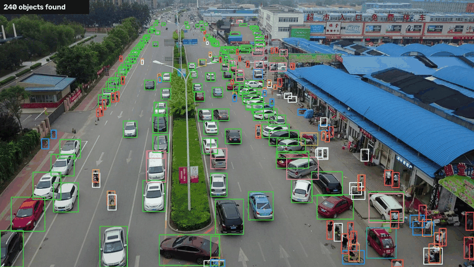

# Drone object detection

People and vehicles seen from a drone are small: of the 75,102 objects in VisDrone's test-dev
split, 68 % are under 32 x 32 pixels in the original photo, and a 2000 x 1500 image shrunk to the
usual 640 px input keeps a third of each object's width. This project trains YOLO26s three ways
and asks which helps small objects more: more pixels in training, more pixels at inference, or
both.

- **Whole image at 640 px**, the default setting.
- **Whole image at 1280 px**, four times the pixels, four times the compute.
- **640 px tiles** with 20 % overlap (slicing-aided inference, Akyon et al., ICIP 2022), trained on
  tiles cut from the training images, predicted tile by tile and merged with class-wise NMS.


<sub>Tile-trained YOLO26s on unseen VisDrone test-dev photos. Images: VisDrone (AISKYEYE,
Tianjin University), for academic use.</sub>

Scores follow the VisDrone toolkit, not plain COCO: ignored regions (crowds, far clutter) and the
"others" class are crowd boxes that neither reward nor punish a detection, and AP counts up to
500 detections per image.

## Results

VisDrone2019-DET test-dev (1610 images), YOLO26s from COCO weights, AP in % over IoU 0.50:0.95;
small objects are under 32 x 32 px in the original image. Time per image on one H100 GPU:

| Training | Inference | AP | AP50 | AP small | AP medium | AP large | ms / image |
|---|---|---|---|---|---|---|---|
| whole image, 640 | whole image, 640 | 17.4 | 30.4 | 8.8 | 26.2 | 38.3 | 7 |
| whole image, 1280 | whole image, 1280 | 25.6 | 43.3 | 15.7 | 36.4 | 47.2 | 8 |
| whole image, 640 | tiles | 18.5 | 33.7 | 12.4 | 25.8 | 22.6 | 13 |
| tiles | tiles | 26.2 | **45.3** | **16.3** | 37.5 | 46.5 | 15 (A100) |
| **tiles** | **tiles + whole image** | **26.5** | **45.3** | 16.2 | **37.7** | **49.6** | 14 |

- **More pixels are what small objects need.** At 1280 px the same network reaches 25.6 AP
  instead of 17.4, and nearly doubles the AP on small objects (15.7 against 8.8), for one
  millisecond more per image on an H100.
- **Tiles need to be trained on.** The 640 model predicted on tiles finds more small objects
  (12.4) but loses large ones that the tile borders cut. Trained on tiles, the same network
  reaches 26.2 AP, and one extra pass over the whole image recovers the large objects: **26.5 AP,
  45.3 AP50 and 49.6 AP on large objects**, the best of all five, at 14 ms per image.
- **Which one to deploy.** Tiles keep a 640 px input, so one model works on any camera
  resolution, from a 2.7K drone camera to a 4K one, by adding tiles. The 1280 model is the
  simpler choice when the camera resolution is fixed and the onboard computer is tight.

The third row uses the same weights as the first row, only predicted on tiles, which separates
the effect of training from the effect of inference.

## Quickstart

```bash
pip install -e ".[train]"
bash scripts/download_models.sh                # COCO-pretrained YOLO26 weights
bash scripts/download_data.sh                  # VisDrone train / val / test-dev, 1.8 GB
aerial-slice --data data/visdrone              # 640 px tiles of train and val + tiles640.yaml
aerial-train --data data/visdrone/visdrone.yaml --imgsz 640 --batch 32 --name visdrone_640
aerial-train --data data/visdrone/tiles640.yaml --imgsz 640 --batch 32 --epochs 40 --name visdrone_tiles640
aerial-eval --model runs/visdrone_640/weights/best.pt --data data/visdrone --split test
aerial-eval --model runs/visdrone_tiles640/weights/best.pt --data data/visdrone --split test --tiled
```

## Training on a GPU cluster (Slurm)

```bash
bash scripts/setup_cluster.sh && bash scripts/download_models.sh && bash scripts/download_data.sh
python3 slurm/generate.py slice --submit       # CPU
python3 slurm/generate.py train --submit       # array: 640, 1280, tiles
python3 slurm/generate.py evaluate --submit    # array: the five rows of the table
```

Account and paths come from `slurm/cluster.toml`; put your account in the git-ignored
`slurm/cluster.local.toml`. Downloads run on a login node, jobs run offline.

## Project layout

```
src/aerial/
  visdrone.py    download, YOLO labels for training, COCO JSON with ignore regions for scoring
  tiling.py      tile grid, training tiles, tiled prediction + merging
  train.py       Ultralytics training with resume
  evaluate.py    COCO AP by object size with 500 detections per image, time per image
```

## Data and licence

The code is MIT-licensed. VisDrone (Zhu et al., TPAMI 2021, AISKYEYE team, Tianjin University) is
for academic use; it is downloaded by the script and never committed.

## References

- P. Zhu et al., *Detection and Tracking Meet Drones Challenge*, TPAMI 2021 (VisDrone).
- F. C. Akyon, S. O. Altinuc, A. Temizel, *Slicing Aided Hyper Inference and Fine-tuning for
  Small Object Detection*, ICIP 2022.
- Ultralytics YOLO26 (2026).
